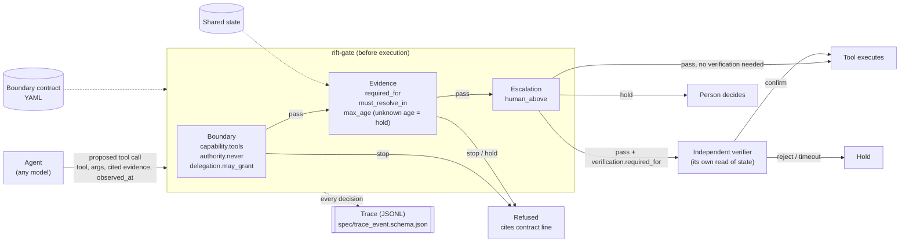

# Architecture

rift-gate sits between an agent and its tools. The agent proposes a tool call; the gate checks it against that agent's boundary contract and the current shared state; only a call that passes every check reaches the tool. Every decision becomes a trace event that cites the contract line responsible.

## What this package does and does not do

| Part | In rift-gate 0.1 |
|---|---|
| Load and validate contracts | Yes (`rift_gate.load`) |
| Boundary, evidence and escalation checks | Yes (`rift_gate.check`) |
| Says whether an action needs a verifier | Yes (`Decision.needs_verification`) |
| Runs the verifier | No. Bring your own; it must read state independently |
| Executes tools | No. Call the tool only when `Decision.allowed` is true and any required verification confirmed |
| Writes traces | Example only (`examples/demo.py`) |
| Tool-protocol adapters (e.g. MCP) | Not yet |

## Where it came from

The checks are extracted from the gate logic of Riftform's RIFT research prototype: one actor agent and one independent verifier on a toy refund desk. In that prototype, run with two small open models from different developers, a forbidden payment call was stopped before execution in 4 of 4 runs, and actions on stale evidence were stopped in 4 of 4. The same runs exposed a fail-open in the freshness check: evidence of unknown age passed. Version 1.1 of the prototype, and this package, hold such evidence instead; that fix has so far been exercised only in unit tests. The prototype compared against no baselines, so none of this shows the approach beats any alternative.
